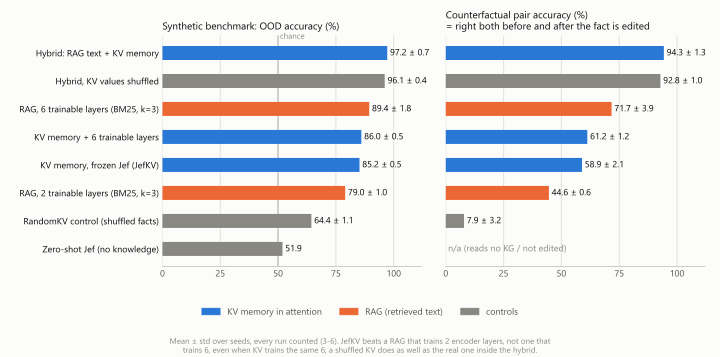
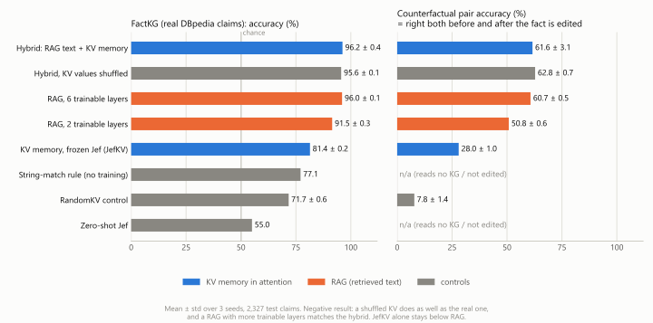

# JefKV: In-Attention Knowledge Graph Memory for a Calibrated Decision Model

**JefKV** is a personal research proof-of-concept. It asks whether **AtlasKV-style parametric KG memory** (Huang et al., ICLR 2026) helps a compact, bidirectional **System-1 decision model**, [Decision-Jef-0.1](https://huggingface.co/BarraHome/Decision-Jef-0.1) (307M, mmBERT-base / ModernBERT), decide rule-dependent cases, and where it does better or worse than plain retrieval-augmented prompting (RAG). It is an independent project, not affiliated with or endorsed by the authors of Decision-Jef or AtlasKV.

> **Status (27/11/2026): negative so far.** On the synthetic benchmark JefKV beats a RAG that trains 2 encoder layers, but a RAG with 6 trainable layers beats it (89.4 / cf 71.7 vs 85.2 / 58.9), also when KV trains the same 6 layers; the synthetic lead was trainable capacity. **On real data (FactKG) JefKV loses to RAG**: alone, with the gold triples forced into its memory, and after training 19 of 22 layers for 3x the steps (cf 67.1 with only the right facts in memory vs 79-81 for RAG with the right facts first in its text). The hybrid's lead comes from its adapter, not from the facts in its KV, on both datasets. Details: "Real data: FactKG", [docs/PREREG_factkg.md](docs/PREREG_factkg.md), [docs/PREREG_synth.md](docs/PREREG_synth.md). The training collapse has a workaround but no explanation. Numbers in "Changes" are from development gate runs.

<picture>
  <source media="(prefers-color-scheme: dark)" srcset="docs/results_dark.svg">
  
</picture>

<picture>
  <source media="(prefers-color-scheme: dark)" srcset="docs/factkg_dark.svg">
  
</picture>

## What is combined

- **Decision-Jef-0.1** answers typed questions in one forward pass and reads each answer at a `[DEC]` token with its own heads. JefKV keeps that decision path and Jef's heads **frozen**, so Jef's calibration is not thrown away.
- **AtlasKV / KBLaM** inject knowledge-graph triples as extra key/value columns into attention, mixed with a separated softmax (JefKV replaces it with a bounded gate, see "Changes"). JefKV wraps Jef's **global** attention layers (3, 6, …, 21). ModernBERT puts global attention every 3 layers, which is also AtlasKV's best injection interval (K=3, Appendix B.3).

## Research questions

1. **Retrieval inside a bidirectional encoder.** Does AtlasKV-style KV memory work inside a frozen ModernBERT, and which global layer retrieves? Checked with the RandomKV control (AtlasKV Appendix E) and per-layer ACC@1/5.
2. **KV memory vs. RAG, on the same budget.** Which wins, and on which kind of case: single rule, rules that must be **combined**, entity names written in a **different surface form**, and **missing** rules?
3. **Knowing when the rule is missing.** When no rule matches, does the model fall back towards 50%, or stay confidently wrong? Measured as confidence on the trap split and the abstention AUROC (confidence separating rule-present from rule-missing cases).

## Changes from the AtlasKV recipe (and why)

| Change | Why |
|---|---|
| **Token-level, layer-matched KV from the backbone itself.** Each triple sentence is encoded by frozen Jef; for each KV layer, the token states (≤16) that this layer's attention sees become its memory slots. W_Q^kg = W_K^kg = identity, W_V^kg = the layer's own W_V (AtlasKV inits W_Q^kg from W_Q). MiniLM sentence vectors (AtlasKV/KBLaM style) are kept as an ablation (`--kv_encoder minilm`). | One sentence vector blurs exact numbers and IDs; token states keep them. Gate run 3 used final-layer states for every layer: queries of layer i did not match them (untrained OOD ACC@5 10–57% vs 95–98% layer-matched), and with W_Q-copied/random K the KG learned only the relation type (ACC@5 ≈ 0 on the 10K test KG). With identity init, layer 3 finds the gold triple (OOD ACC@5 100% among 160) before any training. |
| **Auxiliary retrieval loss** on a ColBERT-style triple score: each case token takes its best slot of the triple (max), averaged over case tokens; −log softmax of the gold triple, per layer. **Inactive in the final setup:** with top-16 routing only the selecting layer (3) retrieves, and its Q/K are frozen, so no layer receives this loss; the later layers learn from the decision loss only (the code path stays for runs without routing). | The benchmark knows which triple is relevant, so retrieval can be supervised directly. Averaging tokens first (gate run 3) scored triples against the whole case, i.e. by relation type: the 2–3 entity tokens were drowned. Eval reports this score's ACC@5 (`score_acc@5`) next to AtlasKV's post-softmax ACC@k. |
| **Retrieve-then-attend inside the model (top-16 routing).** The first KV layer (3) scores every triple (ColBERT score above) and keeps the top 16 per case (its Q/K frozen at identity: training them made it a worse retriever on the 10K test KG, OOD ACC@5 97.5% -> 77.5% in gate run 4); every KV layer attends only to those (~256 slots instead of ~161K), and the later layers re-rank them (auxiliary loss over the 16 candidates). | Gate run 4: retrieval was right (ACC@5 95% on the 10K KG) but attention over all slots let almost none of the right triple's value through: decisions 64% vs 78% for trained RAG, at 710 ms vs 45 ms per case. Layer 3 is the best untrained retriever (OOD ACC@5 97.5% among 2K triples). AtlasKV's HiKVP also keeps a top-k of triples. |
| **One-level GPU K-Means pruning** instead of HiKVP's 3-level UMAP + GMM hierarchy (Sec 4.2, App B.4). | At ≤10K triples the whole memory fits in VRAM; pruning is reported only as a latency/accuracy trade-off. |
| **KG scores in fp32, soft-capped at 50·tanh(x/50)** (Gemma 2 style). | First gate run: the retrieval loss drove KG scores to ~8,000, fp16 overflowed (NaN), and KG attention swamped the sequence so decisions collapsed to 50/50. |
| **Gated mixing instead of the separated softmax**: out = (1−g)·softmax(seq)·V + g·softmax(KG)·V_kg, with g = 0.5·sigmoid(w) per head (init 0.15; g = 0 when no triple is attended). | In the joint softmax the KG's share grows with the number of slots: gate run 2 collapsed to 50/50 (λ_kg ≈ 1), and after a −log(#slots) fix the trained adapter (gate 5) still gave the KG 63–98% of the mass, with [DEC]/number tokens putting 80–94% of it on distractors. KV then ignored the tail (counterfactual pair acc 1.3% ≈ RandomKV). A bounded gate keeps the case readable and makes the KG share independent of KG size. |
| **Triple prior**: the selecting layer's z-scored triple scores (over the top 16) × a learned scalar (init 3) are added to the KG logits of every KV layer. | Later layers re-rank the 16 candidates from their own (weaker) scores; the prior lets them start from the selector's ranking. At init it cut the distractor share of KG mass to 11–16% and sent 27–40% of a number token's KG mass to the gold tail. |
| **Linear LR warmup, 200 steps, for every configuration (KV, RandomKV, hybrid, RAG)** (`--warmup`, default 200; AtlasKV uses cosine decay only). **200 is not tuned**: it is the usual 5–10% of training (200/3000 ≈ 7%), the only value tried, and the same for all baselines so no method gets a tuned schedule. | Added against a training collapse (below), but **it does not remove it**. Without warmup, 1 seed in 3 of every frozen-Jef configuration (KV, RandomKV, hybrid) ended at 50/50 on every split; the collapse is deterministic per seed (the seed sets the batch order, and for RandomKV also the value shuffle; Jef has no dropout: KV seed 2 gave 49.3% twice). Warmup rescued those three seeds (KV s2 49.3 → 81.1%, hybrid s0 54.0 → 97.6%, RandomKV s1 50.7 → 67.5%), but with warmup two *other* seeds collapsed (hybrid s1, RandomKV s2), so it changes which seeds fail, not whether runs fail. Kept because it is harmless (KV 0/6 failures with it, 2/18 frozen-Jef runs over seeds 0–5, RAG −1 to −2 pts, both RAG recipes are reported). Too short a warmup may not damp the first Adam steps; too long a one eats the high-LR part of a 3000-step cosine schedule while the KG curriculum grows, risking under-training. |
| **Retrieval-conditioned temperature**: logits × softplus(w·f + b), f = per-layer [λ_kg, max triple probability]. | Lets the model flatten towards 50% when nothing in the KG matches (RQ3). RAG runs get a learned global temperature only. |

## Baselines (all on the same frozen Jef)

| Name | Knowledge source | Trainable |
|---|---|---|
| `zs_base` | none (Jef zero-shot) | – |
| `zs_rag` | top-3 retrieved triple sentences in the state (dense MiniLM or BM25) | – |
| `rag` | same, evaluated at k = 1, 3, 10 and with BM25 | top 2 encoder layers (10.0M, vs 11.2M for the KV heads) |
| `kv_jef` | full KG in attention (all test triples, or K-Means-pruned on GPU), top-16 routing | KV heads + temperature (11.2M) |
| `kv_jef_unf2` | as `kv_jef` | KV heads + temperature **+ top 2 encoder layers** (21.2M) — diagnostic, see below |
| `kv_minilm` | AtlasKV's own KG2KV: MiniLM key `"the <relation> of <head>"`, value = tail only | KV heads + temperature |
| `hybrid` | RAG context **and** KV memory | KV heads + temperature |
| `kv_jef_randomkv`, `kv_jef_unf2_randomkv` | keys paired with random values (control) | as `kv_jef` / `kv_jef_unf2` |

**`kv_jef_unf2` is a diagnostic, not the main configuration.** Gate run 5: KV ≈ RandomKV (~61%, a prior learnable without knowledge) while trained RAG reached 78%, and RAG also trains the top 2 encoder layers. `unf2` tests whether KV only lacked trainable layers to learn the number comparison. What it trades away:
1. **No longer plug-in** (the main cost): Jef itself changes, so without a KG the model is no longer stock Jef (the pass-through self-test does not hold for this adapter) and Jef's calibration may shift. AtlasKV keeps the LLM frozen.
2. **Unequal budget vs RAG**: 21.2M vs 10.0M trainable. KV vs RandomKV stays fair (same 21.2M); vs RAG the gap is reported.
3. **KG depends on trained weights**: layer-21 keys come from layer 20's output, so training re-encodes the KG every 100 steps (keys up to 100 steps stale) and any model update means re-encoding the whole KG.
4. **Slower training** (backprop through 2 layers + ~30 re-encodes); inference latency unchanged.
5. **More room to learn template shortcuts** from 15K synthetic cases; RandomKV with the same layers measures that part.

If it helps, the results table reports both rows (frozen = AtlasKV's plug-in premise; `unf2` = matched to trained RAG) with these trade-offs.

**Counterfactual tail-swap (`cf` in eval.json, `ood` split).** Plain accuracy can be reached without reading the KG: RandomKV learns a case-only prior of ~61–65%. For each OOD case the gold triple's tail is replaced, in memory (KV) or in the retrieved text (RAG), by a value that flips the correct answer. `pair_acc` = both the original and the swapped case right (≈ 0 for any model that ignores the tail); `flip_rate` = the prediction changes. It proves the tail is read and used, not that the comparison with the case value is exact.

Note on budgets: `kv_full` attends over the *whole* KG (10K triples) while RAG sees only k retrieved sentences. That is the premise of in-attention memory, not an oracle: the model still has to find the right triple, and per-layer ACC@1/5 show whether it does. RAG is also run at k = 10.

## Results (3 seeds, T4)

Mean ± std over seeds 0–2 on the held-out splits (1,000 OOD cases, 500 per other split). `cf pair` = counterfactual tail-swap pair accuracy on OOD (≈ 0 if the KG value is ignored). "collapsed" = runs that ended at ~50% confidence on every split (see below). Warmup 200 unless stated.

| run | collapsed | OOD acc | multi | alias | cf pair | trap conf (→50) | abstain AUROC | ms/case |
|---|---|---|---|---|---|---|---|---|
| zero-shot Jef | – | 51.9 | 50.0 | 49.2 | – | 88.5 | 0.48 | 21 |
| zero-shot Jef + RAG (dense k=3 / BM25 k=3) | – | 51.4 / 51.7 | 49.0 / 52.0 | 49.4 / 48.8 | 0.8 / 1.9 | 94 | 0.48 | 28 / 39 |
| `rag` dense k=3, no warmup | 0/3 | 78.0 ± 1.5 | **62.0 ± 2.4** | 66.9 ± 1.4 | 43.1 ± 1.1 | 71.8 | 0.55 | **29** |
| `rag` BM25 k=3, no warmup (best RAG) | 0/3 | 79.0 ± 1.0 | 58.1 ± 1.1 | 64.1 ± 2.4 | 44.6 ± 0.6 | 67.0 | 0.64 | 44 |
| `rag` dense k=3 | 0/3 | 76.0 ± 2.3 | 60.8 ± 2.1 | **67.2 ± 0.9** | 40.4 ± 2.7 | 70.4 | 0.56 | 30 |
| `rag` BM25 k=3 | 0/3 | 77.9 ± 1.2 | 56.6 ± 0.9 | 64.7 ± 0.6 | 42.7 ± 1.3 | 64.9 | 0.65 | 41 |
| `rag` dense k=10 | 0/3 | 65.6 ± 0.8 | 57.0 ± 1.4 | 63.7 ± 0.8 | 14.2 ± 0.1 | 69.8 | 0.52 | 30 |
| `kv_jef_randomkv` (control) | 1/3 | 60.3 ± 10.9 | 56.8 ± 7.1 | 59.7 ± 6.2 | 10.5 ± 1.9 | 58.8 | 0.52 | 116 |
| `kv_minilm` (AtlasKV KG2KV, 1 seed) | – | 59.9 | 52.8 | 62.2 | 0.0 | 59.7 | 0.50 | 44 |
| **`kv_jef`** (frozen Jef, plug-in) | 0/3 | **84.4 ± 3.2** | **64.2 ± 3.1** | 65.9 ± 1.3 | **58.1 ± 5.5** | 67.2 | 0.68 | 115 |
| `kv_jef_unf2` (diagnostic, not plug-in) | 0/3 | 86.6 ± 0.5 | 66.1 ± 2.0 | 67.9 ± 0.7 | 63.0 ± 3.0 | 70.1 | 0.71 | 113 |
| `hybrid` (RAG text + KV); in brackets: the 2 runs that did not collapse | 1/3 | 82.4 ± 25.6 (97.6, 96.7) | 61.7 ± 8.7 (67.4, 66.0) | 64.9 ± 11.2 (71.4, 71.4) | 63.6 ± 53.1 (95.2, 93.3) | 61.1 (66.0) | 0.79 (0.95) | 175 |

**Seeds 3–5** (frozen-Jef configurations only, free Colab T4, same recipe): none of the 9 runs collapsed. OOD acc / cf pair per seed: `kv_jef` 85.2 / 59.4, 84.5 / 62.2, 84.8 / 60.6; `kv_jef_randomkv` 64.6 / 8.3, 64.9 / 9.3, 64.4 / 5.8; `hybrid` 97.6 / 95.2, 98.1 / 95.8, 96.2 / 93.1. Over seeds 0–5, `kv_jef` is 84.6 ± 2.0 OOD (cf 59.4 ± 3.9, multi 65.3 ± 2.4, alias 66.5 ± 1.8) and the 5 `hybrid` runs that trained are 97.2 ± 0.8 (cf 94.5 ± 1.2).

What this says:
1. **The frozen-Jef KV memory uses the knowledge.** cf pair 58% vs 10% for RandomKV and 0% for AtlasKV's own MiniLM KG2KV (which only learns the ~60% case-only prior).
2. **KV vs RAG (compared with RAG's better recipe):** KV is +5.4 pts on OOD (84.4 vs 79.0) and reads the retrieved fact more reliably (cf 58 vs 45); on rules that must be combined (`multi`) it is +2.2 over the best RAG row on that split (dense k=3, no warmup). RAG stays better on alias names (67.2 vs 65.9), as expected from a text retriever, and is ~3–4× faster (30–44 vs 115 ms per case). **This lead is capacity:** RAG trains 2 encoder layers, KV an 11.2M adapter; a RAG with 6 trainable layers beats KV (89.4 / cf 71.7), also KV with the same 6 layers (see Limitations).
3. **Both together (`hybrid`) is the strongest when it trains** (97% OOD, 94% cf) but collapsed in 1 of 3 runs in each recipe on seeds 0–2 (none of seeds 3–5). On FactKG a hybrid with shuffled KV values did as well as the real one, so its edge there came from capacity, not from the KV facts; the same holds here (shuffled KV 96.1 / 92.8; an edit of the KV alone moves ~1% of the pairs).
4. **Missing rules (RQ3):** no method reaches the ideal 50% confidence on `trap` cases; KV-based models separate rule-present from rule-missing cases better (abstention AUROC 0.68–0.71 for KV, 0.95 for the hybrid runs that trained, vs 0.55–0.65 for RAG). Caveat: half of the temperature head's inputs (λ_kg, set by a static gate) are constant for a given model, so this rests on the max-triple-probability features; the AUROC uses OOD vs trap only.
5. **Pruning:** the K-Means-pruned KV variant (top 8 of 128 clusters on pooled keys) drops the gold triple before routing (layer-3 ACC@5 27% vs 88%): OOD 61.8%, i.e. no knowledge. It halves latency but is not usable as built.

**Cost compared with stock Jef.** Measured on this repo's setup (latency = mean per case in `scripts/eval.py` on a T4, fp16):

| | stock Jef | JefKV (frozen Jef + KV memory) |
|---|---|---|
| Parameters | 307.3M | + 11.2M trainable adapter (+3.6%; 45 MB in fp32) |
| Knowledge memory | none | 172 KB per triple in fp16 (16 token slots × 7 KV layers × 768), i.e. **1.72 GB of GPU memory for the 10K-triple test KG**; for comparison, the MiniLM RAG index for the same triples is ~15 MB (10K × 384 floats) |
| Latency per case | 21 ms (zero-shot) | 115 ms (~5.5×); RAG 28–44 ms, hybrid 175 ms |
| OOD accuracy here | 51.9% (no access to the rules) | 84.6% (best RAG 79.0%, hybrid 97.2%) |
| Without a KG | — | exactly stock Jef (see Limitations for a fully masked KG) |
| Updating a fact | — | re-encode that one triple; no retraining |

The memory grows linearly with the KG, so a KG much larger than ~10K triples needs pruning (the K-Means variant above is broken) or fewer slots per triple. Decision-Jef's model card compares Jef with the hosted Jev API on its own benchmark; this repo does not evaluate Jev, and Jev's size and latency are not published.

**Training collapse (cause open, workaround below).** With Jef frozen, some runs end in an "always 50/50" solution: logit margin ≈ 0 on every case, train decision loss stuck at ≈ 0.59 (= 0.85·ln 2: 50/50 on the 85% of cases that have a rule). The train loss does not show it early, since every run, collapsed or not, sits near 0.57 for its first ~700 steps. The train margin does: in the two logged collapses it fell to ~0 between steps 500 and 700 (hybrid s1; an EMA, so it lags the instrumented run below) and between 1,200 and 1,500 (RandomKV s2). **The mechanism is not established.**
- *What it looks like:* in a collapsed adapter the [DEC] hidden state is the same for every case from layer 11 on (pairwise cosine 1.00), and the KG read-out is 5–12× the sequence read-out in the last KV layers (`scripts/probe_drown.py`).
- *What carries it:* swapping parameter groups between a good and a collapsed KV adapter (no-warmup seeds 1 and 2, 40 OOD cases, `scripts/probe_swap.py`) transfers it with the KG value projections `W_V^kg`. The good adapter with the collapsed `W_V^kg` falls to 30% (margin 0.16); the collapsed adapter with the good `W_V^kg` recovers to 87%. Swapping the gate, prior or temperature changes nothing. Only whole-`W_V^kg` swaps are interpretable: swapping it in layer groups (3–9 or 12–21) breaks both adapters. The collapsed run moved `W_V^kg` *less* from its initialisation than the good one (squared distance 2,388 vs 4,343).
- *When it happens* (instrumented pair, `bash run_all.sh probe`: the same recipe with hybrid s1, which collapses, and s3, which does not; `--probe_every 25` on a fixed batch of 32 training cases): s1 collapsed again (52.9 OOD, as before), and abruptly. Up to step 425 the two runs cannot be told apart on any logged quantity (margin, accuracy, [DEC] cosine, KG:sequence ratio, temperature). At step 450 the KG:sequence read-out ratio of s1 jumps at layers 18 and 21 (0.9 → 2.3 and 0.7 → 2.2) and its margin drops (0.45 → 0.15); at step 475 the ratio is 4.4 / 5.4, the [DEC] state at layer 21 becomes the same for every case (pairwise cosine 0.84 → 0.997) and the margin is 0.03. It never recovers (margin 0.01–0.04 up to step 3,000). s3 keeps a layer-21 ratio of 0.5–0.8 and starts to learn at about the same time (batch accuracy 0.5 → 0.72 by step 500). So the collapse happens when training leaves the initial plateau, and the late-layer KG read-out grows before [DEC] becomes case-independent, within 25–50 steps. The layer-6 ratio and the temperature do not separate the runs (s3 is louder at layer 6). This says when and where, not why.
- *Rescue from just before the onset* (`bash run_all.sh rescue` / `pairs`; resuming from a checkpoint is bit-exact on CPU and GPU, so an unchanged resume repeats the run exactly): from checkpoints 50–100 steps before the onset of three collapses (hybrid s1 with warmup, KV s2 and RandomKV s1 without), the unchanged resume collapsed again 3/3. Each of these single changes avoided the collapse 3/3 within the next ~150 steps: LR × 0.99, relative Gaussian noise 1e-4 on the adapter weights, LR 3e-4, LR 2e-3. A new batch order avoided it in 4/6 (KV s2: both reseeds collapsed). No fp16 step was skipped (loss scale constant) and the batches at the onset look normal. At the onset the `W_V^kg` gradient spikes (norm 3.6, against 0.3–1 before), then its gradient falls ~10× and stays small, so the collapsed state absorbs. A similar spike happened without a collapse in the LR × 0.99 arm. So the collapse is a knife-edge event: a 1% LR change avoids it as well as a 3× smaller or a 2× larger LR, and "LR 3e-4 rescued it" says nothing about the step size. The other two collapses could not be tested this way (hybrid s0 without warmup collapses at step ~110, before the first checkpoint; RandomKV s2 kept a [DEC] cosine of 0.93–0.99, so this stage's cos > 0.99 detector missed it).
- *Workaround, rollback on collapse* (`--rollback_on_collapse 3`, `bash run_all.sh rollback`): the run probes a fixed training batch every 25 steps. After 4 probes in a row with margin < 0.1 and (layer-21 [DEC] cosine > 0.99 or margin < 0.01), it restores an in-RAM snapshot (one every 100 steps) at least 150 steps back, multiplies every adapter weight by (1 + 1e-4·N(0, 1)) and continues with the same batches. On every earlier probe log this rule flagged each of the 5 collapses 75–100 steps after the onset, never before it, and nothing in the 20 logged runs that did not collapse (margin alone misfires: healthy runs dip to 0.05 before step ~300). Without a trigger, a run is bit-identical to one without the flag. Full 3,000-step runs of all 5 known collapsing seeds:

  | seed (collapsed before) | OOD before | rollbacks (detected → restored step) | OOD acc / cf pair | good runs of the same config |
  |---|---|---|---|---|
  | hybrid s1, warmup | 52.9 | 550 → 400 | 97.4 / 94.3 | 97.2 ± 0.8 / 94.5 ± 1.2 (5 runs) |
  | hybrid s0, no warmup | 54.0 | 200 → 0, 775 → 600 | 94.5 / 89.5 | as above |
  | KV s2, no warmup | 49.3 | 875 → 700 | 87.9 / 63.1 | 84.6 ± 2.0 / 59.4 ± 3.9 (6 runs) |
  | RandomKV s1, no warmup | 50.7 | 1075 → 900 | 63.2 / 4.9 | 64.4–64.9 / 5.8–9.3 (seeds 3–5) |
  | RandomKV s2, warmup | 47.8 | 1225 → 1000, 1600 → 1400 | 65.0 / 5.8 | as above |

  Pass criterion, set before the runs: no collapse at the end and accuracy on par with the good runs of the same configuration. 5/5 did not collapse. 4/5 are on par; hybrid s0 is 2.7 points below the mean of the good hybrid runs and below the lowest of them (96.2). Two runs collapsed a second time, later, and were rolled back again, so one nudge does not keep a run out for good. Each rollback repeats 150–250 steps (5–8% of a run), plus the probes. The tables above report runs *without* rollback. Only the 5 seeds that defined the problem were tested, and the mechanism is still open.
- *How often (no restarts):* without warmup, 3 of 9 frozen-Jef runs (seeds 0–2) collapsed; with warmup 200, 2 of 18 (seeds 0–5: KV 0/6, RandomKV 1/6, hybrid 1/6; 95% CI 1.4–34.7%), 0 of 18 after restart on collapse (below); with the top 2 Jef layers trainable, 0/6. It is deterministic per seed (the seed sets the batch order, and for RandomKV also the value shuffle, so a restarted RandomKV run is also a differently shuffled control).
- *Workaround, restart on collapse* (`--restart_on_collapse 2`): if an EMA of the train margin is below 0.1 at step 1,500, the run restarts with seed + 1000. This uses training batches only, and it is a selection step, not a fix: a restarted run costs up to 50% more compute. Both collapsed warmup seeds were caught (EMA 0.014 and 0.002) and retrained into normal runs: hybrid s1 52.9 → 97.5 OOD (cf 94.9), RandomKV s2 47.8 → 66.8 (cf 7.6). The tables above report runs *without* restarts. Restarted numbers are conditional on the first attempt failing, and a collapse after step 1,500 would not be caught (the KG curriculum keeps growing until step 2,900); none was seen in 18 runs.
- *Fixes screened* (one factor each; kv_jef seeds 0–2, RandomKV s2 and hybrid s1, the last two being the seeds that collapsed with the default recipe):
  - Freezing `W_V^kg` at its initialisation (`--freeze_kg_v`): 0/5 collapsed, but the knowledge is gone: kv_jef OOD 64.4–67.2 / cf 16.5–17.4 (about the RandomKV level), hybrid 64.7 / cf 22.0. `W_V^kg` has to train.
  - Adapter LR 3e-4 instead of 1e-3, seeds 0–2 of all three frozen-Jef configurations: 0/9 collapsed with unchanged accuracy. kv_jef 85.1 OOD / cf 57.2 on average (default recipe 84.4 / 58.1); hybrid 97.4 / cf 94.5 (s0 97.7 / 95.4, s1 97.0 / 92.6, s2 97.5 / 95.4; default recipe, 2 good runs: 97.2 / 94.3); RandomKV 66.6–68.9 / cf 12.4–20.1 (s2: 8.5 at LR 1e-3: the control's leak through its keys depends on the LR; a stronger control can only shrink KV's measured advantage). Seeds 3–5 (`bash run_all.sh seeds_lr`, T4): 0/9 collapsed again, so 0/18 in all; over 6 seeds kv_jef 85.2 OOD / cf 56.9 (s3–5: 84.4 / 54.4, 88.4 / 62.6, 82.8 / 52.9), hybrid 97.5 / cf 94.3 (s3–5: 97.4 / 93.8, 98.0 / 95.3, 97.3 / 93.4), RandomKV s3–5 67.0–69.6 / cf 16.6–16.8: same accuracy as LR 1e-3. **Still not evidence of a fix:** at the 2/18 base rate of the default recipe, 18 clean runs happen by chance about 12% of the time (95% CI for 0/18: 0–19%; Fisher exact against 2/18, one-sided p = 0.24), and the rescue tests above show that any small change avoids a given collapse. The tables keep LR 1e-3; rollback stays the recommended guard.
  - Capping the KG read-out at the sequence's RMS (gate run 8, one seed): cost ~11 pts OOD, dropped.
- *Recommended recipe for new runs:* the default recipe plus `--rollback_on_collapse 3` (5/5 known collapses trained, see above). `--restart_on_collapse 2` also worked (2/2) but costs up to 50% more compute and misses collapses after step 1,500. `--lr 3e-4` had 0/18 collapses (p = 0.24 against 2/18), but the rescue tests show that a 1% LR change also avoids a given collapse, so this count is the only evidence for it. The defaults in the code stay as published so that the tables reproduce.
- *Next:* rollback on seeds that never collapsed, to measure false triggers and cost; why the gradients die after the onset.

Per-seed numbers are in each `runs/<config>_s<seed>/eval.json`; `bash run_all.sh full` also writes means to `outputs/results.md` and plots. The no-warmup RAG rows come from `rag_nowarm_s*` (same stage).

**Fresh test set** (`bash run_all.sh fresh`, `results/fresh/`): the adapters above, re-evaluated on a new synthetic test set (generator seed 7, no entity name shared with train or the original test). OOD acc / cf pair: `kv_jef` 84.9 ± 1.2 / 57.8 (3 seeds), best RAG (BM25, no warmup) 80.1 ± 0.8 / 48.3, `kv_jef_unf2` 86.5 / 63.6, hybrid 98.0 / 96.4 and 97.6 / 94.7 (s1 is the collapsed run: 51.0), RandomKV 62.2 / 7.6, AtlasKV MiniLM KG2KV 62.0 / 0.0, zero-shot 50.7. The design decisions made on the original test split did not inflate the KV numbers.

**Recommended recipe on seeds 0–5** (`--rollback_on_collapse 3`, `bash run_all.sh rb_check`, `results/rb_check/`, RTX 3090 fp16): every run counted, none dropped. `kv_jef` 85.2 ± 0.5 OOD / 58.9 ± 2.1 cf (6 seeds), hybrid 97.2 ± 0.7 / 94.3 ± 1.3 (6), RandomKV 64.4 ± 1.1 / 7.9 ± 3.2 (5; s4's eval ran out of GPU memory three times). One rollback fired in 17 runs (RandomKV s2) and no run collapsed. The seeds that collapsed on the T4 (hybrid s1, RandomKV s2) did not collapse here the same way: the GPU changes the numerics, so a seed's trajectory does not carry over between GPUs, and this is not an out-of-sample test of the rollback rule. The headline figure uses these numbers.

## Real data: FactKG (negative result)

[FactKG](https://github.com/jiho283/FactKG) (Kim et al., ACL 2023, [arXiv:2305.06590](https://arxiv.org/abs/2305.06590)) has claims about DBpedia entities labelled True / False. The converter (`scripts/factkg_convert.py`) keeps one-hop claims with two entities and one relation, takes the claim's triples plus same-entity distractors as the KG (train 11,353 claims / 25,700 triples; test = FactKG dev, 2,327 claims / 4,883 triples) and picks, per claim, a real tail that flips the label for the counterfactual. Same recipe, same budget and same eval as the synthetic runs. **The FactKG data (CC BY-NC-SA 4.0; KG: DBpedia 2015, CC BY-SA 3.0) is not in this repo**, only metrics (`results/factkg*`).

A critical review of this repo (confounds: adapter capacity, the hybrid's selector reading the RAG text, retriever mismatch, a training shortcut, duplicate gold rows, a biased oracle) and two rounds of model cross-review turned into a plan with decision rules fixed before running: [docs/PREREG_factkg.md](docs/PREREG_factkg.md) (with its deviations and outcome). 3 seeds each, all runs counted:

| (2,327 test claims) | acc | cf pair | notes |
|---|---|---|---|
| zero-shot Jef | 55.0 | – | answers True almost always |
| string-match rule (`scripts/factkg_rule_baseline.py`) | 77.1 | – | True iff a KG triple's head and tail both occur in the claim |
| RandomKV | 71.7 ± 0.6 | 7.8 ± 1.4 | |
| **JefKV** (`kv_jef`) | **81.4 ± 0.2** | **28.0 ± 1.0** | the deciding triple is in the selector's top-16 for 55% of claims (seed 2; True 69%, False 39%) |
| JefKV, gold forced into its top-16 (oracle) | 88.1 | 41.4 | the reader's ceiling with this training recipe |
| RAG dense k=3, 2 trainable layers (as on synthetic) | 91.5 ± 0.3 | 50.8 ± 0.6 | |
| hybrid (RAG text + KV) | 96.2 ± 0.4 | 61.6 ± 3.1 | |
| hybrid, cf edit applied to the KV only / text only | – | 1.4 / 58.4 | the hybrid follows its text, not its KV |
| hybrid trained with shuffled KV values | 95.6 ± 0.1 | 62.8 ± 0.7 | post-hoc check |
| RAG dense k=3, 6 trainable layers | 96.0 ± 0.1 | 60.7 ± 0.5 | post-hoc check |

What this says:
1. **JefKV alone loses to RAG on real data**, on accuracy and on following an edited fact, and is only 4 points above string matching. Even with the gold triples forced into its top-16 it stays below RAG (88.1 / 41.4 vs 91.5 / 50.8). The frozen layer-3 selector has the deciding triple in its top-16 for only 55% of the claims.
2. **The hybrid's lead over RAG is adapter capacity, not KG knowledge.** Editing a fact only in the hybrid's KV moves 1.4% of the counterfactual pairs; editing only its retrieved text gives 58.4 of the 62.0. A hybrid trained with shuffled KV values does as well as the real one, and a RAG with 6 trainable layers matches both. The hybrid's encoder is frozen, so its KV branch (11.2M parameters in 7 layers, at 50× RAG's learning rate) works as a text-conditioned adapter with the KG states as a fixed basis.
3. **Scale and latency** (seed 0, KG grown with unrelated real triples, RTX 3090): RAG stays at 91.5% and ~24 ms per claim from 5k to 50k triples; the hybrid keeps its accuracy (96.7 → 96.5) but goes from 75 to 223 ms at 20k triples and runs out of GPU memory (24 GB) at 50k, as does RandomKV. The layer-3 selector scores every triple, so cost grows with the KG.
4. **Not ruled out:** a reader trained with hard negatives (same-entity distractors in the training KG), a trained selector, or a validation-tuned RAG. Training batches now draw distractors at random, so "is the claimed tail anywhere in the KV" nearly solves training, and the string-match rule shows how far that goes.

**Follow-ups (27/11/2026, each registered before running in [docs/PREREG_factkg.md](docs/PREREG_factkg.md)): is the KV reader just under-trained?** `kv_oracle_goldonly` = the memory holds only the claim's gold triples; RAG-oracle = the gold triples first in RAG's text.

| | KV gold-only (acc / cf) | KV natural routing | RAG-oracle, same trainable layers | RAG natural |
|---|---|---|---|---|
| T1: frozen KV, 32 tokens per triple instead of 16 (eval only) | 87.6 / 47.7 | | | 91.5 / 50.8 (2 layers) |
| T2: KV with 6 trainable layers, 32 tokens, 3k steps (3 seeds) | 91.9 / 56.9 | 79.5 / 22.2 | 97.1 / 79.8 | 96.0 / 60.7 |
| T3: same, 9k steps (2 seeds) | 95.8 / 67.1 | 82.0 / 24.0 | 98.1 / 81.2 (seed 0) | 96.9 / 61.8 |
| T3: 19 trainable layers, 9k steps (2 seeds) | 96.4 / 67.1 | 83.9 / 24.6 | 98.2 / 79.1 (seed 0) | 98.2 / 65.3 |

16 tokens cut the tail (the fact) of 21% of the test triples; 32 tokens recover +6.7 cf on those claims. Training longer helps the KV reader (+10.2 cf from 3k to 9k steps, at the registered threshold for "under-trained"), training more layers does not, and with the right facts only it stays 12-14 cf below RAG with the right facts, at a training loss of ~0.01 (RAG ~0). With its own routing the gap is ~40 cf: the frozen layer-3 selector is the bigger problem, and training the upper layers made it no better (frozen KV: 81.4 / 28.0).

**Considered and not run (27/11/2026): "many facts per decision".** The one place a KV memory could have a structural edge is a decision that needs more facts than RAG can fit in its text. Two rounds of model brainstorm and cross-review, checked against the code, advised against running it: the backbone reads 8,192 tokens (our RAG uses 512 and k=3 only by configuration), so a fair RAG takes k >= N facts and sees them all; the KV selector keeps at most 16 triples and scores each triple by a mean over every query token, so N entities in one case dilute each other; and KV already trails RAG with 1-2 facts, even with only the gold facts in memory, and is slower (75-223 ms vs ~24 ms at 20k triples). No result of a cheap gate would have changed that, so the KV line stops here.

**Could a gate that picks KV or RAG per claim help? (post-hoc, 27/11/2026, `scripts/complement.py` on the per-claim predictions, 3 seeds.)** KV is right where RAG6 (dense k=3) is wrong on 2.1-2.5% of the claims, and follows an edit RAG6 misses on 3.6-4.2% of the pairs. A second RAG6 seed gives 0.7-1.3% and 3.7-4.2%, and a BM25 RAG6 1.8% and 8.3%. Picking the more confident of the two models: KV + RAG6 95.9-96.2 (RAG6 alone 95.8-96.1), RAG6 + RAG6 96.3-96.7, BM25 + dense 96.3. So KV adds no more than another RAG seed, and less than another retriever: an adaptive KV/RAG gate has nothing to select.

Details: `results/factkg_s0/gates.txt` (per seed, population and variant, incl. the claims RAG misses and claims with unseen head entities: same picture), `results/factkg_s0b/`. Caveats: no validation split (S0 was decided on the test split), 79/2,327 test claims had a duplicated gold row in the data used (the converter is fixed, the data not regenerated; the eval edits every duplicate), 364 test claims have their gold triple in the train KG.

## Limitations (read before citing a number)

- **Adapter capacity confound (tested 27/11/2026).** RAG trains its top 2 encoder layers at LR 2e-5; KV and hybrid train an 11.2M-parameter adapter in 7 layers at 1e-3. Re-tested on synthetic ([docs/PREREG_synth.md](docs/PREREG_synth.md), `results/synth_cap`, 3 seeds): a RAG with 6 trainable layers (89.4 / cf 71.7, BM25 k=3) beats frozen KV (85.2 / 58.9) and KV with the same 6 trainable layers (86.0 / 61.2); only on `multi` is KV ahead (66.2 vs 60.6, dense RAG 65.7). So the synthetic KV-vs-RAG gap in "Results" is capacity, as on FactKG. A RAG with a higher encoder LR was not tried.

- **No separate validation split.** The design decisions in "Changes" (gate runs 1–9) were made by looking at the test split. The re-evaluation on a fresh test set (new entities, different generator seed, see "Results") gave the same numbers.
- **Synthetic, single-family task.** One kind of rule (is the observed number within an entity's limit), 4 domains, English pseudo-word entities. Values at the edges of a domain's range give the label without any knowledge, which is why models with no access to the KG reach ~60% (RandomKV, MiniLM KG2KV) and why the counterfactual `cf pair` metric is reported.
- **RandomKV is a conservative control.** It shuffles values only (AtlasKV App. E); its keys still contain each triple's own tail tokens, so a weak key-side channel remains (its cf pair is 10%, not 0%). This can only make the control stronger, i.e. shrink KV's measured advantage.
- **Training exposure differs.** KV training batches always contain the gold triples plus a growing set of distractors (AtlasKV's curriculum); RAG trains on what its retriever returns (dense k=3, ~97% gold recall on OOD). At test time both use the same full 10K-triple KG.
- **Hybrid cf is not KV-only.** In the hybrid, a counterfactual edit changes both the KV memory and the retrieved sentence, so its cf (≈94) cannot be attributed to the KV memory alone. Split 27/11/2026 (`results/synth_diag`, 2 seeds): an edit of the KV alone moves 1.4 / 0.9 of the synthetic pairs, of the text alone 94.2 / 94.1, and a hybrid with shuffled KV values reaches 96.1 / 92.8. As on FactKG (1.4), the hybrid follows its text, not its KV.
- **Plug-in holds exactly only without a KG.** With no KG passed, a KV model is exactly stock Jef (self-test). A trained adapter given a KG whose slots are all masked still applies its learned temperature (factor 1.027 for `kv_jef` seed 1), so its logits differ slightly from stock Jef.
- **cf asymmetry.** For RAG the edited tail replaces the gold sentence only if the unedited index retrieved it; for KV the edited triple is re-encoded in memory and re-scored. The edit only changes the tail number, which is not in the query, so retrieval is expected to be essentially unchanged.
- **One backbone, small seeds count.** 3 seeds per configuration (plus seeds 3–5 for the frozen-Jef ones); 2 of 18 frozen-Jef runs with warmup collapsed (see above).

## Benchmark (synthetic, `data/generate_benchmark.py`)

Four policy domains (return window, expense limit, warranty, baggage). Each case asks whether an observed value is within the entity's limit; the limit exists only in the KG. Entity names are pronounceable pseudo-words; train, test and missing-rule names are disjoint, and nothing in the text reveals whether a rule exists.

| Split | Cases | What it tests |
|---|---|---|
| `ood` | 1,000 | single rule, 10K unseen test entities |
| `multi` | 500 | needs the entity limit **plus** a customer-tier bonus rule (the observed value always exceeds the base limit) |
| `alias` | 500 | entity written differently from the KG (`velorakin`, `Ve Lo Ra Kin`, `VE-LO-RA-KIN`) |
| `trap` | 500 | entity has no rule; ideal confidence ≈ 50% |

Limits: synthetic English data, numeric threshold rules only; Jef itself is English-only.

## Project structure

```text
jefkv/attention.py        gated KG attention (KV memory) for ModernBERT global layers (transformers 5.x)
jefkv/memory.py           KG memory (Jef token states or MiniLM), GPU K-Means pruning, dense + BM25 retrievers
jefkv/model.py            Decision-Jef wrapper: KV injection, frozen [DEC] heads, retrieval-conditioned temperature
data/generate_benchmark.py synthetic benchmark (--exclude builds a test set with no shared entity names)
scripts/train.py          modes kv | rag | hybrid, --random_kv, --kv_encoder, --freeze_kg_v, --restart_on_collapse,
                          --rollback_on_collapse, --probe_every (training diagnostics on a fixed batch),
                          --ckpt_at / --resume / --perturb / --reseed / --step_log (rescue tests)
scripts/eval.py           accuracy, ECE, trap confidence, abstention AUROC, counterfactual cf, ACC@1/5, latency
scripts/plot_results.py   results.md (mean ± std over seeds) + plots
scripts/plot_summary.py   the README headline figure (docs/results_*.svg)
scripts/probe_*.py        diagnostics: KG vs sequence read-out (drown), parameter swaps (swap), KG gate (lambda)
scripts/check_overlap.py  entity-name overlap between two benchmark files
scripts/collapse_onset.py checkpoint just before a logged collapse (stage pairs)
tests/test_jefkv.py       self-check: no KG == stock Jef; masked KG == stock Jef; live KG changes output
run_all.sh                all stages (smoke | gate | full | seeds | restart | screen_* | fresh | ...)
run_modal.py              run a stage on a Modal T4
colab/run_stage.sh        run a stage on a free Colab T4 (Colab CLI)
```

## Running

```bash
pip install -r requirements.txt          # pinned: transformers 5.24.0, decision-jef 0.8.1
PYTHONPATH=. python tests/test_jefkv.py  # ~1 min on CPU once weights are cached
bash run_all.sh smoke                    # every code path on tiny data, CPU
bash run_all.sh gate                     # step 1 on a GPU: clean KV vs RandomKV (seed 0)
bash run_all.sh full                     # all configs x 3 seeds + zero-shot baselines -> outputs/results.md
```

`gate` is a stop/go check: if the clean-KG loss does not separate from the RandomKV loss, the KV heads are not retrieving and the rest is not worth running. On a T4 training runs in fp16 automatically. Other stages: `warm` (the warmup check above), `seeds` (seeds 3–5 of the frozen-Jef configs), `restart` (restart on collapse), `screen_lr` / `screen_fkv` (the two collapse fixes), `probe` (the instrumented pair), `rescue` / `pairs` (resumes from just before a collapse), `rollback` (rollback on the 5 known collapses), `confirm_lr` / `seeds_lr` (more LR 3e-4 seeds: 0–2, then 3–5), `fresh` (re-evaluation on a fresh test set), `unf`, `rag`.

Where to get a GPU (Modal and Colab ran this code on a T4; one KV run ≈ 10 min incl. eval, `full` ≈ 3–4 h):

| Option | Cost | How |
|---|---|---|
| Colab (free T4) | free, subject to Colab's usage limits | Colab CLI (Linux/macOS/WSL): `uv tool install google-colab-cli`, then `bash colab/run_stage.sh <stage>`; results in `runs_colab/<stage>/`, fetched after every finished run because a free runtime can be reclaimed mid-stage |
| Modal (T4) | ~$0.25 per run, ~$3.5 for `full` | `modal deploy run_modal.py && python run_modal.py <stage>` (keeps running if your machine disconnects; `modal run --detach` did not), results on the `jefkv-runs` volume, then `modal app stop jefkv` |

## References & Acknowledgments

This project builds directly upon the following papers, architectures, and open-source releases:

1. **AtlasKV (Core Parametric KG Memory Method):** Haoyu Huang, Hong Ting Tsang, Jiaxin Bai, Xi Peng, Gong Zhang, and Yangqiu Song. *AtlasKV: Augmenting LLMs with Billion-Scale Knowledge Graphs in 20GB VRAM*. Published at **ICLR 2026** ([arXiv:2510.17934](https://arxiv.org/abs/2510.17934) | [Official GitHub](https://github.com/HKUST-KnowComp/AtlasKV)).
2. **KBLaM (Rectangular Attention Paradigm):** Xi Wang, Taketomo Isazawa, Liana Mikaelyan, and James Hensman. *KBLaM: Knowledge Base Augmented Language Model*. 2024 ([arXiv:2410.10450](https://arxiv.org/abs/2410.10450)).
3. **Decision-Jef-0.1 (System-1 Calibrated Decision Model):** `BarraHome`. *Decision-Jef-0.1* (307M calibrated decision model). 2026 ([Hugging Face](https://huggingface.co/BarraHome/Decision-Jef-0.1)).
4. **mmBERT (Multilingual Encoder Backbone):** Marc Marone, Orion Weller, William Fleshman, Eugene Yang, Dawn Lawrie, and Benjamin Van Durme. *mmBERT: A Modern Multilingual Encoder with Annealed Language Learning*. 2025 ([arXiv:2509.06888](https://arxiv.org/abs/2509.06888) | [GitHub](https://github.com/jhu-clsp/mmBERT) | [Hugging Face](https://huggingface.co/jhu-clsp/mmBERT-base)).
5. **ModernBERT (Alternating Local/Global Attention Architecture):** Benjamin Warner, Antoine Chaffin, Benjamin Clavié, Orion Weller, Oskar Hallström, Said Taghadouini, Alexis Gallagher, Raja Biswas, Faisal Ladhak, Tom Aarsen, Griffin Thomas Adams, Jeremy Howard, and Iacopo Poli. *Smarter, Better, Faster, Longer: A Modern Bidirectional Encoder for Fast, Memory Efficient, and Long Context Finetuning and Inference*. **ACL 2025**, pp. 2526–2547 ([ACL Anthology](https://aclanthology.org/2025.acl-long.127/) | [arXiv:2412.13663](https://arxiv.org/abs/2412.13663)).
6. **Sentence-BERT & MiniLM (Default Lightweight Sentence Encoder):**
   - Nils Reimers and Iryna Gurevych. *Sentence-BERT: Sentence Embeddings using Siamese BERT-Networks*. 2019 ([arXiv:1908.10084](https://arxiv.org/abs/1908.10084)).
   - Wenhui Wang, Furu Wei, Li Dong, Hangbo Bao, Nan Yang, and Ming Zhou. *MiniLM: Deep Self-Attention Distillation for Task-Agnostic Compression of Pre-Trained Transformers*. **NeurIPS 2020** ([Hugging Face: all-MiniLM-L6-v2](https://huggingface.co/sentence-transformers/all-MiniLM-L6-v2)).
7. **FactKG (Real-Data Benchmark):** Jiho Kim, Sungjin Park, Yeonsu Kwon, Yohan Jo, James Thorne, and Edward Choi. *FactKG: Fact Verification via Reasoning on Knowledge Graphs*. **ACL 2023**, pp. 16190–16206 ([ACL Anthology](https://aclanthology.org/2023.acl-long.895/) | [arXiv:2305.06590](https://arxiv.org/abs/2305.06590) | [GitHub](https://github.com/jiho283/FactKG)). Data CC BY-NC-SA 4.0, not redistributed here.
8. **Core Foundations (Transformer & AdamW):**
   - Ashish Vaswani et al. *Attention is All You Need*. **NeurIPS 2017**.
   - Ilya Loshchilov and Frank Hutter. *Decoupled Weight Decay Regularization*. 2017 ([arXiv:1711.05101](https://arxiv.org/abs/1711.05101)).

### BibTeX

```bibtex
@inproceedings{huang2026atlaskv,
  title     = {AtlasKV: Augmenting LLMs with Billion-Scale Knowledge Graphs in 20GB VRAM},
  author    = {Huang, Haoyu and Tsang, Hong Ting and Bai, Jiaxin and Peng, Xi and Zhang, Gong and Song, Yangqiu},
  booktitle = {International Conference on Learning Representations (ICLR)},
  year      = {2026},
  eprint    = {2510.17934},
  archivePrefix = {arXiv},
  primaryClass  = {cs.CL},
  url       = {https://arxiv.org/abs/2510.17934}
}

@article{wang2024kblam,
  title   = {KBLaM: Knowledge Base Augmented Language Model},
  author  = {Wang, Xi and Isazawa, Taketomo and Mikaelyan, Liana and Hensman, James},
  journal = {arXiv preprint arXiv:2410.10450},
  year    = {2024},
  url     = {https://arxiv.org/abs/2410.10450}
}

@article{marone2025mmbert,
  title   = {mmBERT: A Modern Multilingual Encoder with Annealed Language Learning},
  author  = {Marone, Marc and Weller, Orion and Fleshman, William and Yang, Eugene and Lawrie, Dawn and Van Durme, Benjamin},
  journal = {arXiv preprint arXiv:2509.06888},
  year    = {2025},
  url     = {https://arxiv.org/abs/2509.06888}
}

@inproceedings{warner2025modernbert,
  title     = {Smarter, Better, Faster, Longer: A Modern Bidirectional Encoder for Fast, Memory Efficient, and Long Context Finetuning and Inference},
  author    = {Warner, Benjamin and Chaffin, Antoine and Clavi{\'e}, Benjamin and Weller, Orion and Hallstr{\"o}m, Oskar and Taghadouini, Said and Gallagher, Alexis and Biswas, Raja and Ladhak, Faisal and Aarsen, Tom and Adams, Griffin Thomas and Howard, Jeremy and Poli, Iacopo},
  booktitle = {Proceedings of the 63rd Annual Meeting of the Association for Computational Linguistics (Volume 1: Long Papers)},
  pages     = {2526--2547},
  year      = {2025},
  url       = {https://aclanthology.org/2025.acl-long.127/}
}

@misc{barrahome2026decisionjef,
  title        = {Decision-Jef-0.1: Calibrated System-1 Decision Model},
  author       = {{BarraHome}},
  year         = {2026},
  howpublished = {\url{https://huggingface.co/BarraHome/Decision-Jef-0.1}}
}

@inproceedings{wang2020minilm,
  title     = {MiniLM: Deep Self-Attention Distillation for Task-Agnostic Compression of Pre-Trained Transformers},
  author    = {Wang, Wenhui and Wei, Furu and Dong, Li and Bao, Hangbo and Yang, Nan and Zhou, Ming},
  booktitle = {Advances in Neural Information Processing Systems (NeurIPS)},
  volume    = {33},
  pages     = {5776--5788},
  year      = {2020}
}

@article{reimers2019sentencebert,
  title   = {Sentence-BERT: Sentence Embeddings using Siamese BERT-Networks},
  author  = {Reimers, Nils and Gurevych, Iryna},
  journal = {arXiv preprint arXiv:1908.10084},
  year    = {2019},
  url     = {https://arxiv.org/abs/1908.10084}
}

@article{loshchilov2017decoupled,
  title   = {Decoupled Weight Decay Regularization},
  author  = {Loshchilov, Ilya and Hutter, Frank},
  journal = {arXiv preprint arXiv:1711.05101},
  year    = {2017}
}

@inproceedings{vaswani2017attention,
  title     = {Attention is All You Need},
  author    = {Vaswani, Ashish and Shazeer, Noam and Parmar, Niki and Uszkoreit, Jakob and Jones, Llion and Gomez, Aidan N. and Kaiser, {\L}ukasz and Polosukhin, Illia},
  booktitle = {Advances in Neural Information Processing Systems (NeurIPS)},
  volume    = {30},
  year      = {2017}
}
```

## How this was built (AI assistance)

Code, experiments and this README were written with Claude Opus 5.5 (Claude Code). Design decisions and code were also brainstormed and cross-reviewed by other models, each given the measurements and code, not the conclusions:

| Model | Used for |
|---|---|
| Gemini 4 Neon High | brainstorming at decision points, code reviews (found 4 real bugs in the gate-5 code), cross-review of merged plans (e.g. a "0/14 ≈ 1% collapse" claim was wrong: Fisher p ≈ 0.14 against the baseline) |
| Gemini 4 Argon High | code review |
| Gemini 3.8 Flash Low | checking the implementation against the AtlasKV paper (curriculum, KG2KV key/value format, ACC@k) |
| GPT-6 Luna | brainstorming and cross-review (e.g. screening the collapse fixes one factor at a time, as `screen_lr` / `screen_fkv` do, instead of combining them) |
| DeepSeek V4.1 Flash | code reviews (e.g. an infinite gradient from a clamp placed after a `sqrt` in the dropped RMS cap) |
| Hy4 Flash | brainstorming and cross-review of the collapse analysis |

The gated mixing + triple prior design (gate run 7) came out of one such brainstorm. For the training collapse, a second round gave the four models our own reading of the probes to attack. They showed that three of our conclusions were overstated (a probe that centred the wrong quantity, a comparison across warmup settings, a loss plateau that non-collapsing runs share), which is why the "Training collapse" paragraph reports measurements and leaves the mechanism open. Every finding was checked and re-run before use, and several suggestions were rejected after checking. All numbers in this README come from the runs, not from the models.

## License

MIT — see [`LICENSE`](LICENSE) and [`CITATION.cff`](CITATION.cff) for full attribution details.

Third-party weights and packages are downloaded at run time, not redistributed here (no weights, adapters or vendored code in this repo). Decision-Jef-0.1, its base model `jhu-clsp/mmBERT-base` and the `decision-jef` package are MIT; `sentence-transformers/all-MiniLM-L6-v2` is Apache-2.0; the Python dependencies are MIT / Apache-2.0 / BSD-3 / PSF. AtlasKV is re-implemented from the paper (no code taken from its repository). Decision-Jef's model card notes that part of its training data (`tasksource/tasksource-jev-typed-decisions`) carries `license: other` and that this has not been reviewed by its author. The AtlasKV paper is linked, not included.
